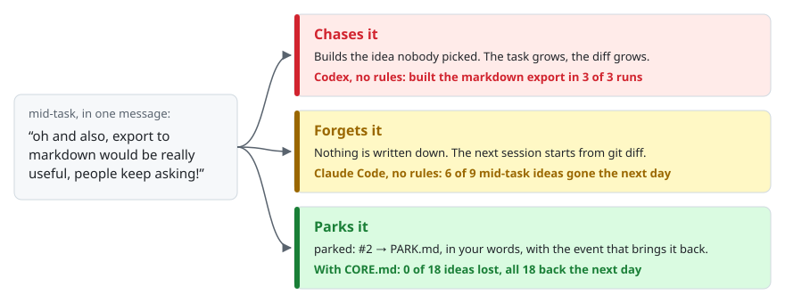
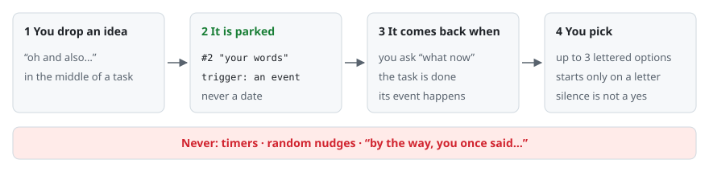
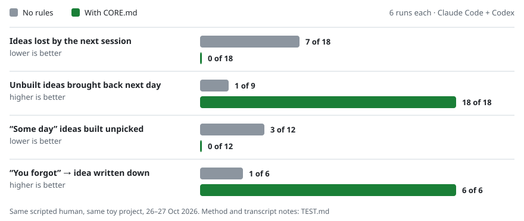

<p align="center">
  <picture>
    <source media="(prefers-color-scheme: dark)" srcset="assets/mascot-dark.svg">
    
  </picture>
</p>

# my human has ADHD

**Your coding agent chases your ideas or forgets them. This one parks them.**

18 lines for Claude Code, Codex and Cursor. Drop an idea mid-task ("oh and also…") and the agent writes it to `PARK.md` in your words, with the event that should bring it back, then finishes the step. No scope creep, no ideas lost between sessions, one question at a time, "done" only with proof. Built for ADHD brains; works for everyone.

<p align="center">
  <picture>
    <source media="(prefers-color-scheme: dark)" srcset="assets/hero-dark.svg">
    
  </picture>
  <br>
  <a href="#install-30-seconds">Install</a> · <a href="#how-it-works">How it works</a> · <a href="#what-we-measured">Measured</a> · <a href="#faq">FAQ</a>
</p>

## Chase it or lose it

You say "oh, and also…" in the middle of a task. The agent has nowhere to put a thought that is not for now, so it does one of two things: it builds it (scope creep, work you didn't ask for) or it drops it (gone when the session ends). We ran the same scripted human against Claude Code and Codex and saw both.

<picture>
  <source media="(prefers-color-scheme: dark)" srcset="assets/problem-dark.svg">
  
</picture>

## Install (30 seconds)

Add [`CORE.md`](CORE.md) to the rules file your agent always reads: `CLAUDE.md` for Claude Code, `AGENTS.md` for Codex, `.cursorrules` for Cursor.

```bash
curl -fsSL https://raw.githubusercontent.com/fri3ndslab/my-human-has-adhd/main/CORE.md >> CLAUDE.md
```

PowerShell (`cmd` keeps the file in UTF-8):

```powershell
cmd /c "curl -fsSL https://raw.githubusercontent.com/fri3ndslab/my-human-has-adhd/main/CORE.md >> CLAUDE.md"
```

Or open [`CORE.md`](CORE.md), copy the 18 lines, paste them. That is the whole install: no script, no plugin, no API key. Put it in `~/.claude/CLAUDE.md` to have it in every project; it is about the person, not the repo.

`PARK.md` is a plain file in your project. Git-ignore it if your ideas are private; in a team repo, commit it, and the park becomes the shared list of what people actually said.

## How it works

<picture>
  <source media="(prefers-color-scheme: dark)" srcset="assets/flow-dark.svg">
  
</picture>

1. **Park, don't chase.** An idea that is not the current step goes into `PARK.md` in your exact words, with the event that should bring it back ("before we publish", "when the settings page exists"; no obvious event: `when idle`). The agent says `parked: #3` and returns to the step. "Add X" is a task, not an idea: it comes next.
2. **Bring it back only at the right moment:** you ask "what now" or "what did we have", the current task is done with nothing next, or the trigger has happened. Up to 3 ideas, as lettered options, the agent's pick first. An idea starts only when you pick it; "ok" is not a pick. Never on a timer.
3. **One question, once.** At most one lettered question per message. If you talk about something else, the question is dropped; silence is not an answer.
4. **Proof, not praise.** "Done" comes with the file or the test count.
5. **"You forgot."** The agent writes the idea back with `missed` at the end of the line and says `missed: #7`. No argument. `grep -c missed PARK.md` is the honest number.

## What we measured

Same scripted human, same toy project, Claude Code and Codex, 3 runs per agent in each arm. The human asks for one feature, drops three ideas on the way, comes back the next day with "what now?", then says "you forgot".

<picture>
  <source media="(prefers-color-scheme: dark)" srcset="assets/results-dark.svg">
  
</picture>

The 102-line [long version](#the-long-version) scored the same on all of these; the 18-line core was faster (54 s against 120 s per Claude run). Every run, the misses and the text fixes they led to: [`TEST.md`](docs/TEST.md). Limits: one scenario, written by us; a toy project; one model per agent.

**In our own work.** This came out of a private multi-human, multi-agent workspace, where the park has its own small script and a panel. Over 10 days it took 49 ideas: 19 were offered back, 9 were built, 8 were dropped on purpose, 32 are still waiting for their event. Counts only; the ideas stay private.

## What it looks like

Real, 11 Oct 2026, project details removed. Mid-way through a Cloudflare question, in one message: *"for sites like the other one you need a separate image CDN so a takedown on the image host doesn't take the main site down… but that's my ADHD talking, this project isn't that one."*

```
agent: parked: #1 "separate image CDN so a takedown doesn't take the main site down"  trigger: before the other site goes live
       Which one first? (A) Tunnel, my pick  (B) R2  (C) Workers AI  (D) none of these
```

The idea is in the park with the event that brings it back. The open question did not move. More in [`EXAMPLES.md`](docs/EXAMPLES.md), including two wrong ones.

## The park file

```
- [ ] 2026-10-11 #2 "dark mode"  trigger: when the settings page exists
- [x] 2026-10-09 #1 "rename the repo"  trigger: when idle
- [-] 2026-10-02 #0 "rewrite in Rust"  trigger: when idle
- [ ] 2026-10-10 #3 "the webhook retry thing"  trigger: when idle  missed
```

`[ ]` parked · `[x]` done · `[-]` dropped · `missed` = the agent forgot and you said so.

## FAQ

**Is it only for ADHD?**
No. It was written by someone with ADHD, for the agent sitting across from them, and no diagnosis is needed. The scripted human in the test was not ADHD-specific: everyone says "oh, and also…".

**Why a rules file and not a memory plugin?**
Memory tools remember what the agent saw. This keeps one short list: what you said that is not for now, in your words, with the event that brings it back. You can open it, edit it, and grep it.

**Will my agent stop building things I didn't ask for?**
In our runs, Codex without rules built a "would be useful" idea in 3 of 3 runs; with `CORE.md` it parked it in 3 of 3. Claude Code without rules did not chase, but lost 6 of 9 ideas by the next session; with `CORE.md` it lost none.

**Does it wear off in long sessions?**
It can. The rules sit in the always-loaded file, so every turn sees them. Claude Code users can add a one-line hook ([the long version](#the-long-version)). When the agent misses one, say "you forgot": it goes back in the file, marked `missed`.

**Does anything leave my machine?**
No. `PARK.md` is a plain text file in your project. Nothing is sent anywhere.

**Does it work in Cursor?**
It works with any agent that reads a rules file. We measured Claude Code and Codex; Cursor is not measured yet.

**How is it different from other ADHD skills?**
[i-have-adhd](https://github.com/ayghri/i-have-adhd) and [attention-span](https://github.com/alexgreensh/attention-span) fix the **output**: action first, no filler. Use them with this one. [claude-adhd](https://github.com/shaheer-00/claude-adhd) remembers unfinished threads with a transcript indexer, nudges and a dashboard. This one has no code on purpose: a text file, event triggers instead of time, and a hard "no unasked reminders" rule, because a random nudge is exactly the interruption we were trying to avoid.

**Why no script?**
Scripts need a runtime, a path, a version. A rule plus a text file works in every agent, every language, every repo. Want numbers? Count the lines: parked, done, dropped, missed.

## The long version

[`SKILL.md`](skills/my-human-has-adhd/SKILL.md) (102 lines) is the full working agreement: weights, `shown` and `none` counters, a `now: task — step 3/5` line at the top of every message and one two-minute action at the end. It scored the same as the core in our runs and was slower; use it if you want that structure.

Claude Code, project-level (bash):

```bash
mkdir -p .claude/skills/my-human-has-adhd && curl -fsSL https://raw.githubusercontent.com/fri3ndslab/my-human-has-adhd/main/skills/my-human-has-adhd/SKILL.md -o .claude/skills/my-human-has-adhd/SKILL.md
```

PowerShell:

```powershell
New-Item -ItemType Directory -Force .claude/skills/my-human-has-adhd | Out-Null; iwr https://raw.githubusercontent.com/fri3ndslab/my-human-has-adhd/main/skills/my-human-has-adhd/SKILL.md -OutFile .claude/skills/my-human-has-adhd/SKILL.md
```

Also paste [`CLAUDE.snippet.md`](skills/my-human-has-adhd/CLAUDE.snippet.md) into your `CLAUDE.md`, `AGENTS.md` or `.cursorrules`: a skill loads only when its description matches the message, the rules file is always loaded. Codex and Cursor users need only the snippet.

**Optional, Claude Code only:** long sessions drift. One line of config, no script, re-states the rule every turn. Put it in `.claude/settings.json`:

```json
{ "hooks": { "UserPromptSubmit": [ { "hooks": [ { "type": "command", "command": "echo 'my-human-has-adhd: check PARK.md before replying'" } ] } ] } }
```

<p align="center">
  
  <br>
  <sub>The long version in a sandbox run, 11 Oct 2026; agent lines shortened, not reworded.</sub>
</p>

## Where it comes from

Extracted from a private multi-human, multi-agent workspace. The first version there had a panel and a Node script; in 30 days it parked 14 ideas and brought none back, because "bring it back" depended on the agent remembering. This file is the part that does not depend on memory: the park is on disk, the rule sits in the always-loaded rules file.
